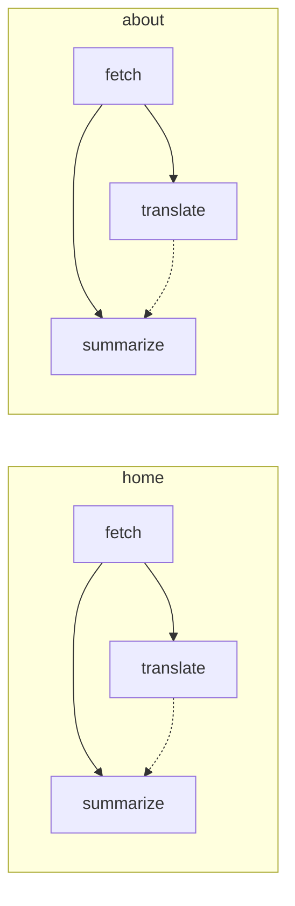

# Build a graph

This page shows how to write the actions and nodes that [How it works](../README.md#how-it-works) describes. It starts from one whole program: two pages, each fetched, translated and summarised, where translating may fail. Every export it uses is in the [API reference](api/index.md).

```ts
import {
  actionsFor,
  createMemoryDagFs,
  execute,
  file,
  Graph,
  maybe,
  MemCache,
  nodeInputs,
  settled,
  type DagFs,
  type FileInput,
  type OutputRef,
} from "@mrmeku/dagraph";

interface Ports {
  fs: DagFs;
}
const limits = { network: 2 };
const defineActionWithPorts = actionsFor<Ports, keyof typeof limits>();

const fetchPage = defineActionWithPorts({
  kind: "fetch",
  nodeInputs: nodeInputs<{ url: string }>,
  inputs: { version: 1 },
  concurrencyGroup: "network",
  action: async ({ inputs, outputDir, ports }) => {
    const html = `${outputDir}/page.html`;
    await ports.fs.writeText(html, `<p>${inputs.url}</p>`);
    return { html };
  },
});

const translate = defineActionWithPorts({
  kind: "translate",
  deps: { page: fetchPage },
  action: async ({ depOutputs, outputDir, ports }) => {
    const html = `${outputDir}/fr.html`;
    await ports.fs.writeText(html, (await depOutputs.page.html.text()).toUpperCase());
    return { html };
  },
});

const summarize = defineActionWithPorts({
  kind: "summarize",
  deps: { page: fetchPage, translation: settled(translate), notes: maybe<{ notes: string }> },
  nodeInputs: nodeInputs<{ style: FileInput; argv: (string | OutputRef<string>)[] }>,
  action: async ({ inputs, depOutputs, outputDir, ports }) => {
    const style = await inputs.style.text();
    const argv = inputs.argv.map((a) => (typeof a === "string" ? a : a.path));
    const translated = depOutputs.translation ? await depOutputs.translation.html.text() : "none";
    const summary = `${outputDir}/summary.txt`;
    await ports.fs.writeText(
      summary,
      [style, argv.length, translated, depOutputs.notes?.notes.path ?? "no notes"].join(" | "),
    );
    return { summary };
  },
});

type Meta = { page: string } | { site: true };
const graph = new Graph<Ports, Meta>();
for (const id of ["home", "about"]) {
  const pageGraph = graph.subgraph(id, { page: id });
  const page = fetchPage.addNode(pageGraph, { inputs: { url: `https://example.com/${id}` } });
  const translation = translate.addNode(pageGraph, { deps: { page } });
  summarize.addNode(pageGraph, {
    deps: { page, translation: settled(translation) },
    inputs: ({ page }) => ({ style: file("/style.txt"), argv: ["render", page.html] }),
  });
}

const fs = createMemoryDagFs({ "/style.txt": "terse" });
const results = await execute(graph, {
  ports: { fs },
  fs,
  cache: new MemCache(),
  casBaseDir: "/cas",
});
```

All six nodes succeed, and `home:summarize` writes `terse | 2 | <P>HTTPS://EXAMPLE.COM/HOME</P> | no notes`. This is the graph it builds, drawn as shown under [Draw a graph](#draw-a-graph). A dashed edge is a settled dependency. Each section below explains one part of the program.



## Actions and nodes

`defineAction(spec)` defines an action that needs no tools. A program with tools binds its own once, as `actionsFor<Ports, keyof typeof limits>()` does above. Its actions get `ports: Ports` in their context, and may join only the concurrency groups it names. The limit itself belongs to the scheduler that runs the graph ([Run a graph](execution.md)).

In the spec, `kind` names the action's logic and joins every node's cache key. `action` is `async (context) => outputs`. `deps` declares the roles each node fills, `nodeInputs` the inputs each node gives, and `inputs` the ones every node shares, such as `{ version: 1 }`. `invalidateOn` and `cacheable` change what the key covers and whether a node is cached at all ([When a node runs again](caching.md)). `concurrencyGroup` and `timeoutMs` change how it runs ([Run a graph](execution.md)).

The action's context holds `inputs`, `depOutputs`, `ports`, `outputDir`, a `signal` that fires on a timeout or a cancel, and `output(chunk)` for text it prints. The action returns its outputs as a record of names, each a path or a list of paths. The output type is exactly what it returns. So `fetchPage` has outputs `{ html: string }`, and `translate` can read `depOutputs.page.html`. Only `inputs` and `depOutputs` join the key, not the function, so a change to the action's logic needs a bump to an input such as `version`.

You add a node through its action, never the graph: `fetchPage.addNode(graph, { name, meta, deps, inputs })`. It returns a ref, the typed handle you give to the nodes that depend on it.

## Dependencies

A role is the name under which an action reads a dependency: `page` in `deps: { page: fetchPage }`. Each node fills it with a ref, and the action reads that node's files as `depOutputs.page`.

A role is required unless marked. When a required dependency fails, the node is held back and settles `dep-failed`, naming the dependency. A `settled(...)` role works like `Promise.allSettled`: the node waits for the dependency, then runs whether it succeeded or not. A node fills it with `settled(ref)`, as the example fills `translation`. Had `translate` thrown, both summarize nodes would still run, reading `depOutputs.translation` as `undefined`.

A `maybe(...)` role is one a node may leave out, as these nodes leave out `notes`, which then reads `undefined`. Both kinds of role are typed `| undefined`, so the compiler makes the action check before reading. The [API reference](api/index.md) gives each marker's forms.

## Inputs

A node's inputs are its action's own `inputs` merged with the node's. The key reads every one by name, so changing one runs the node again. `nodeInputs<T>` declares what each node gives, and a missing or mistyped input doesn't compile.

Value inputs are JSON only: strings, finite numbers, booleans, `null`, and arrays and plain records of these.

`file(path)` is a file input. The path as written and the file's bytes join the key, so editing the file runs the node again. The action reads it as a handle, as `summarize` reads `inputs.style`.

To put a dependency's output into a value, such as an argv list for a command, give `inputs` as a function, as each summarize node does. The function gets each role's output refs. So `page.html` here is a ref to the fetched html, not the node ref `page` passed in `deps`. `["render", page.html]` puts that ref in the list, and the action reads the item as a handle on the fetched file.

## Files and outputs

An action reads every file through a handle, whether it comes from a `file()` input or a dependency's output. A handle has:

- `path`, the absolute path while the action runs, for a command or library that wants one;
- `text()`, the contents as UTF-8;
- `json(guard)`, the contents parsed and checked by a type guard;
- `hash()`, the SHA-256 of its bytes.

Write only under `outputDir`, a new, empty directory for this attempt. The engine moves the directory once the action returns. Returned paths are rewritten for you, but paths written inside a file are not. So a file that names another output of the same node, such as an index naming its pages, must name it relative to itself.

## Give actions their tools

Ports are the program's tools, such as a file system, an HTTP client or a translator. They go in the execution context, never in the graph, so the same graph runs against real tools in production and against fakes in a test. `actionsFor<Ports>()` types them, and the graph takes the same type: `new Graph<Ports>()`, with the meta type second if there is one, as in the example.

## Test an action

To test one action, add one node of it to a fresh `Graph<Ports>` and execute it as the example does. Seed `createMemoryDagFs()` with its input files, and pass it both as the context's `fs` and as the `fs` port. Add a `MemCache`, and fakes for the other ports. The memory file system holds only what goes through it, so the action must write with `ports.fs.writeText`.

An action with a required role can't be added alone. Add a node for that role first, as the example adds each `fetch` before its `translate`.

Then read the output. Narrow the result with `isSucceeded`, and take a path with `namedOutput(result.outputs, name)`. Look that path up in the memory file system's `.files`, a `Map` from path to contents. [Run a graph](execution.md) covers the context and results.

## Names, subgraphs and meta

A node is named after its kind unless you give it a `name`. Names are unique in a graph, so two nodes of one action in one scope need names of their own. `graph.subgraph(prefix, meta)` is a view that names each node added through it `prefix:<name>` and gives it that meta. That is how the example's loop gets `home:fetch` and `about:fetch` without explicit names. Meta says what a node is about, for a listener, a scheduler or a diagram to group by.

## Draw a graph

`graph.describe()` is the graph as plain data: each node's name, kind, meta and dependencies. `mermaidBody` from `@mrmeku/dagraph/mermaid` turns it into the body of a Mermaid flowchart. Add this import to the program's imports and the rest to its end, and it prints the diagram near the top of this page:

```ts
import { mermaidBody } from "@mrmeku/dagraph/mermaid";
const { lines } = mermaidBody(graph.describe(), {
  subgraphOf: (m) => (m && "page" in m ? m.page : ""),
  label: (n) => n.kind,
});
console.log(["flowchart LR", ...lines].join("\n"));
```

You add the header yourself. `subgraphOf` boxes each node by its meta, and `label` sets the text in its box, which defaults to its full name. The other options are in the [mermaid reference](api/mermaid.md).
